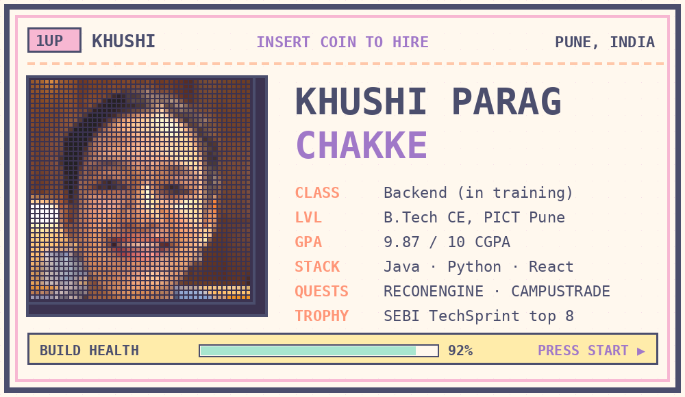

 

&nbsp;&nbsp;
&nbsp;&nbsp;

 

## 🕹️ Status

 

<b>📜 Quest log (click to expand)</b>

 

**⚔️ ReconEngine · Agentic Financial Reconciliation**
- Matches transactions between internal ledgers and settlement records, and investigates discrepancies
- 4 matching strategies (exact, tolerance, reference, composite) across 10,000+ records
- 4 LangGraph agents coordinated via shared state and conditional routing
- Async PostgreSQL workers using `FOR UPDATE SKIP LOCKED`, with retries and dead-letter handling
- 35 test cases · transactions, unique constraints, and trigger-based audit logs

**🛒 CampusTrade · Peer-to-Peer Campus Marketplace**
- React.js frontend with Node.js/Express REST APIs over MongoDB
- Real-time buyer–seller messaging over WebSockets, secured with JWT and role-based access
- Compound indexing and pagination cut documents examined per feed query from **10,000 to 12**

**💼 Research Intern · Software Development (Dec 2025 – May 2026)**
- Delivered 12+ features for a live app serving 200+ active users, with zero post-release rollbacks
- Took part in testing a gated CI/CD pipeline that cut release time from days to under 2 hours

 

## 📌 Pinned

  
  

<!-- Pin cards pull live data. Make sure the repo names match your GitHub. -->

## 📊 Stats

  
  

  

  

 

🌸 INSERT COIN TO CHAT · THANKS FOR PLAYING 🌸

