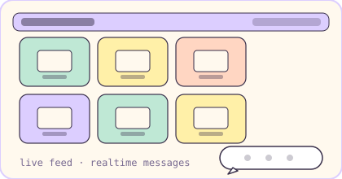

<!--
  KHUSHI.OS profile README
  Regenerate art:  python scripts/make_khushios_assets.py
                   python scripts/make_ascii_svg.py source-prepped.png assets/portrait-ascii.svg
                   python scripts/make_wordmark_svg.py --mode rock --out assets/wordmark.svg
                   python scripts/make_pixel_sprite.py <photo> assets/pixel-sprite.gif
                   python scripts/generate_streak_svg.py Khushi-426 assets/contrib-heatmap.svg
-->

  

<table>
<tr>
<td valign="top"></td>
<td valign="top"></td>
</tr>
</table>

<b>Backend Developer · Agentic AI Builder · Computer Engineering @ PICT</b>

  <code>khushi@os:~$</code>
  <a href="#whoami">whoami</a> &nbsp;·&nbsp;
  <a href="#skills">skills</a> &nbsp;·&nbsp;
  <a href="#quests">quests</a> &nbsp;·&nbsp;
  <a href="#projects">projects</a> &nbsp;·&nbsp;
  <a href="#activity">activity</a> &nbsp;·&nbsp;
  <a href="#achievements">achievements</a> &nbsp;·&nbsp;
  <a href="#contact">contact</a>

 

### `khushi@os ~ $ whoami`

<table>
<tr>
<td valign="top"></td>
<td valign="top"></td>
</tr>
</table>

Computer Engineering undergraduate at PICT (9.87/10 CGPA) with six months of backend development experience building features for live products. Skilled in Java, C++, Python, Node.js and PostgreSQL, with hands-on experience in AI-agent orchestration, database optimization and CI/CD. I'm interested in building reliable backend systems and practical AI-driven applications.

**Experience: Research Intern (In-House), Software Development, Dec 2025 – May 2026**

- Designed and delivered 12+ features for a live application serving 200+ active users, building REST APIs backed by a relational SQL database, with zero post-release rollbacks across Agile sprints.
- Ran feature delivery end to end: requirement analysis, design discussions with senior engineers, implementation, code reviews, regression testing and root-cause analysis before release.
- Took part in discussions and testing of a gated CI/CD pipeline for a 5-microservice system, with approval checks and rollback support, as part of an initiative that cut release time from days to under 2 hours.

 

### `khushi@os ~ $ ls skills/`

 

### `khushi@os ~ $ cat quests.md`

These are learning goals I'm actively working on, not completed achievements.

- **Database performance.** Go further on query and index optimization, building on the compound indexing and pagination work behind CampusTrade's feed.
- **Stateful AI-agent systems.** Move from a working LangGraph prototype toward reliable, resumable multi-agent workflows, building on ReconEngine's shared state and conditional routing.
- **Release engineering.** Keep sharpening gated CI/CD and rollback practice across services.
- **Problem solving.** Keep practicing DSA on LeetCode and CodeChef, where I've solved 400+ problems so far.
- **German.** Progress past Goethe A1.

 

### `khushi@os ~ $ ls -l projects/`

<table>
<tr>
<td valign="top"></td>
<td valign="top"></td>
</tr>
</table>

#### ReconEngine: Agentic Financial Reconciliation Platform

**Stack:** Node.js · PostgreSQL · Python · FastAPI · LangGraph · React · Docker

Matches transactions between internal ledgers and external settlement records, then coordinates the investigation of whatever doesn't match.

- **Matching:** processes 10,000+ records with four strategies (exact, tolerance, reference and composite) and raises exceptions for unmatched transactions.
- **Agents:** a FastAPI service where LangGraph coordinates 4 specialized agents through shared state and conditional routing, covering discrepancy investigation, evidence gathering and resolution recommendations.
- **Workers:** asynchronous PostgreSQL-backed workers using `FOR UPDATE SKIP LOCKED`, with automatic retries, dead-letter handling and stalled-job recovery to prevent duplicate job claims.
- **Reliability:** validated through 35 test cases, with data integrity enforced by transactions, unique constraints and trigger-based audit logging.

Repository: [github.com/Khushi-426/reconengine](https://github.com/Khushi-426/reconengine)

#### CampusTrade: Peer-to-Peer Campus Marketplace

**Stack:** React.js · Node.js · Express.js · MongoDB · REST APIs · WebSockets

A full-stack marketplace for campus buying and selling.

- **Marketplace:** searchable, filterable listings, with distinct user and administrator workflows across the listing lifecycle.
- **Messaging and security:** real-time buyer–seller messaging over WebSockets, JWT authentication, role-based authorization, ownership checks, server-side input validation and rate limiting.
- **Performance:** compound indexing, pagination, response compression and connection pooling cut documents examined per feed query from 10,000 to 12 (99.88%) and feed payload from 3.0 MB to 6 KB. Verified with functional and benchmark test suites.

Repository: [github.com/Khushi-426/campus](https://github.com/Khushi-426/campus)

 

### `khushi@os ~ $ ./contributions.sh`

 

### `khushi@os ~ $ cat achievements.log`

- **Finalist, SEBI Securities Market TechSprint 2026:** top 8 among 2,664 teams, for an AI-driven SME IPO disclosure solution.
- **Finalist, Compute n Compete 2025:** top 20 among 100 teams at PICT ACM Student Chapter (PASC).
- **Problem solving:** 400+ DSA problems solved across LeetCode and CodeChef.
- **Goethe-Zertifikat A1, Goethe-Institut:** certified German A1 proficiency. [View certificate](https://drive.google.com/file/d/1ot8kmhaAbhVZia2JMqYNuzHXZMtLf9L8/view)

 

### `khushi@os ~ $ connect`

 

KHUSHI.OS · process exited 0 · thanks for stopping by

